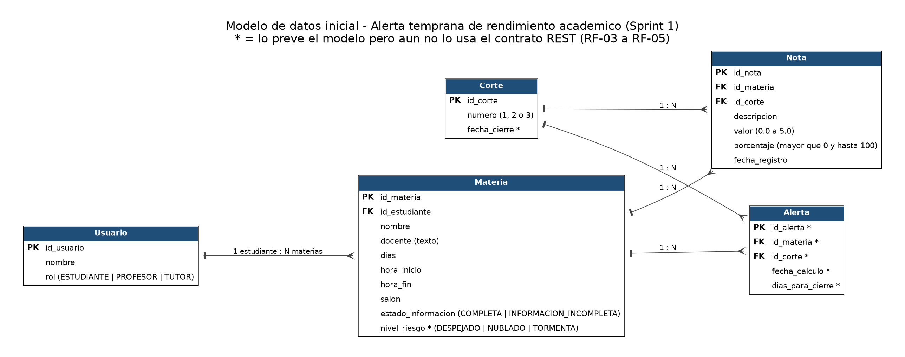

# Modelo de datos inicial

Proyecto: Alerta temprana de rendimiento académico (Grupo 5). Entregable de Datos del Sprint 1 (Jira: SCRUM-8), revisado por Backend contra el contrato REST (SCRUM-7 y SCRUM-14).

Estado: borrador inicial. En este sprint los datos viven en memoria (sin base de datos) y se usa un estudiante de prueba fijo, sin autenticación.

## Diagrama

El asterisco (*) marca lo que el modelo ya prevé pero el contrato REST del Sprint 1 todavía no usa (RF-03 a RF-05).

## Entidades

| Entidad | Atributos (PK / FK) | Estados | Relaciones | Restricción / RN |
|---|---|---|---|---|
| Usuario | **PK** id_usuario, nombre, rol | ESTUDIANTE, PROFESOR, TUTOR | Como estudiante tiene muchas materias | Cada rol solo accede a lo suyo (RN-04, RNF-02). En el Sprint 1 se usa un estudiante de prueba fijo |
| Corte | **PK** id_corte, número (1, 2 o 3), fecha_cierre* | — | Tiene muchas notas y alertas* | La fecha de cierre es obligatoria para calcular alertas (CDU-03) |
| Materia | **PK** id_materia, **FK** id_estudiante, nombre, docente (texto), días, hora_inicio, hora_fin, salón | Información: COMPLETA / INFORMACION_INCOMPLETA (se calcula, RF-04: un corte con notas está completo si sus porcentajes suman 100%; un corte sin notas se ignora; una materia sin ninguna nota es INFORMACION_INCOMPLETA). Riesgo*: DESPEJADO / NUBLADO / TORMENTA | Pertenece a un estudiante; tiene muchas notas y alertas* | Nombre, docente, horario y salón obligatorios (CA-01.2). Si la información está incompleta no se calcula riesgo ni alerta (RN-01, RNF-03) |
| Nota | **PK** id_nota, **FK** id_materia, **FK** id_corte, descripción, valor, porcentaje, fecha_registro | — | Pertenece a una materia y a un corte | Valor entre 0.0 y 5.0 (CA-02.2, CA-02.3). Porcentaje mayor que 0 y hasta 100. Los porcentajes de un corte en una materia suman máximo 100% |
| Alerta* | **PK** id_alerta, **FK** id_materia, **FK** id_corte, fecha_cálculo, días_para_cierre | — | Pertenece a una materia y a un corte | Guarda fecha y corte (RNF-01) y días para el cierre (RF-05). Solo existe si la información está completa (RN-01). Siempre sale con la opción de asesoría (RN-02) |

## Supuestos y decisiones

- **Rango de notas:** 0.0 a 5.0.
- **Docente:** texto en el Sprint 1. Pasa a ser un usuario con rol profesor cuando exista autenticación.
- **Roles:** estudiante, profesor y tutor (se usa "tutor" por consistencia; "monitor" aparece en algunos documentos).
- **Corte:** el contrato recibe el corte como número (1, 2 o 3), que corresponde a `Corte.número`.
- **Riesgo (RF-03):** definido en el documento «Definición y validación de la fórmula de riesgo académico», según el Reglamento General Estudiantil de la UAM (Acuerdo 001 de 2026). Ver la sección «Regla de cálculo del riesgo».
- **Información completa (RF-04), regla confirmada:**
  1. Un corte con notas está completo si sus porcentajes suman 100%.
  2. Un corte sin notas se ignora (por ejemplo, una materia con los cortes 1 y 2 al 100% y el corte 3 sin notas es COMPLETA).
  3. Una materia sin ninguna nota es INFORMACION_INCOMPLETA.
  Los datos de prueba (SCRUM-38) cubren los tres casos: materia 1 sin notas (incompleta), materia 2 con el corte 2 al 60% (incompleta) y materia 4 con los tres cortes al 100% (completa).
- **Alcance:** las solicitudes de tutoría (RF-06 y RF-07) y la evolución del promedio (RF-08) no están en este modelo inicial.

## Regla de cálculo del riesgo (RF-03, SCRUM-65)

Fuente: documento «Definición y validación de la fórmula de riesgo académico», aprobado por Producto, con los arts. 37, 39 y 42 del Reglamento General Estudiantil de la UAM. Lo implementa Backend en `service/CalculadoraRiesgo` (SCRUM-63).

**Peso de cada corte en la nota final (art. 37):** corte 1 = 30%, corte 2 = 35% y corte 3 = 35%. Las notas de cada corte suman 100% dentro del corte (RF-02).

**Fórmulas** (solo con información completa, RF-04):

1. Nota del corte k, solo para cortes completos, redondeada a un decimal (art. 39): Nk = Σ (Ni × Pi / 100).
2. Nota acumulada: Na = Σ (Nk × Wk / 100).
3. Porcentaje restante: Pr = 100 − Σ Wk de los cortes completos. Los cortes sin notas forman Pr.
4. Nota necesaria, solo si Pr > 0: Nnecesaria = (2.95 − Na) / (Pr / 100). Se usa 2.95 porque la nota definitiva se redondea a un decimal y 2.95 ya es 3.0 (art. 39).

**Clasificación**, sobre la nota necesaria sin redondear:

| Nivel | Condición |
|---|---|
| DESPEJADO | Nnecesaria ≤ 3.5 |
| NUBLADO | 3.5 < Nnecesaria ≤ 4.5 |
| TORMENTA | Nnecesaria > 4.5 |

Los umbrales 3.5 y 4.5 son provisionales.

**Casos especiales:**

- Información incompleta: no hay nivel de riesgo, nota acumulada ni nota necesaria (null) (RN-01).
- Nnecesaria ≤ 0: DESPEJADO; la respuesta muestra 0.
- Nnecesaria > 5.0: TORMENTA; aprobar ya no es posible con lo que falta.
- Pr = 0: no se divide. La nota final se redondea a un decimal y se compara: ≥ 3.0 es DESPEJADO y < 3.0 es TORMENTA (por ejemplo, 2.95 → 3.0 aprueba y 2.94 → 2.9 no).
- Precisión: las comparaciones con 3.0, 3.5 y 4.5 usan una tolerancia de 0.000001, porque con decimales de máquina 3.5 puede salir 3.5000000000000004 y 3.0 puede salir 2.9999999999999996.

**Datos de prueba** (`repository/DatosDePrueba`): una materia por caso, con una nota de 100% en cada corte. Los valores esperados están comprobados con `CalculadoraRiesgo`.

| Id | Materia | Cortes | Na | Pr | Nnecesaria | Nivel |
|---|---|---|---|---|---|---|
| 4 | Estructuras de Datos | 3.8 · 3.8 · 3.8 | 3.8 | 0 | — (final 3.8) | DESPEJADO |
| 6 | Física Mecánica | 3.0 · 2.5 | 1.775 | 35 | 3.36 (ejemplo A) | DESPEJADO |
| 7 | Química General | 2.5 · 2.5 | 1.625 | 35 | 3.79 (ejemplo B) | NUBLADO |
| 8 | Estadística | 1.9 · 3.3 | 1.725 | 35 | 3.5 (límite) | DESPEJADO |
| 9 | Probabilidad | 0.5 · 3.5 | 1.375 | 35 | 4.5 (límite) | NUBLADO |
| 10 | Física Eléctrica | 0.5 · 3.0 | 1.2 | 35 | 5.0 | TORMENTA |
| 11 | Ecuaciones Diferenciales | 1.5 · 2.0 | 1.15 | 35 | 5.14 (imposible) | TORMENTA |
| 12 | Inglés I | 5.0 · 5.0 | 3.25 | 35 | 0 (ya aprobó) | DESPEJADO |
| 13 | Ética | 3.0 · 3.0 · 3.0 | 3.0 | 0 | — (final 3.0) | DESPEJADO |
| 14 | Contabilidad | 2.6 · 3.1 · 3.1 | 2.95 | 0 | — (final 2.95 → 3.0) | DESPEJADO |
| 15 | Economía | 2.8 · 3.0 · 3.0 | 2.94 | 0 | — (final 2.94 → 2.9) | TORMENTA |
| 16 | Sistemas Operativos | 2.9 · 2.9 · 2.9 | 2.9 | 0 | — (final 2.9) | TORMENTA |

Las materias 1, 2, 3 y 5 siguen con información incompleta (RF-04), así que no tienen nivel de riesgo.
