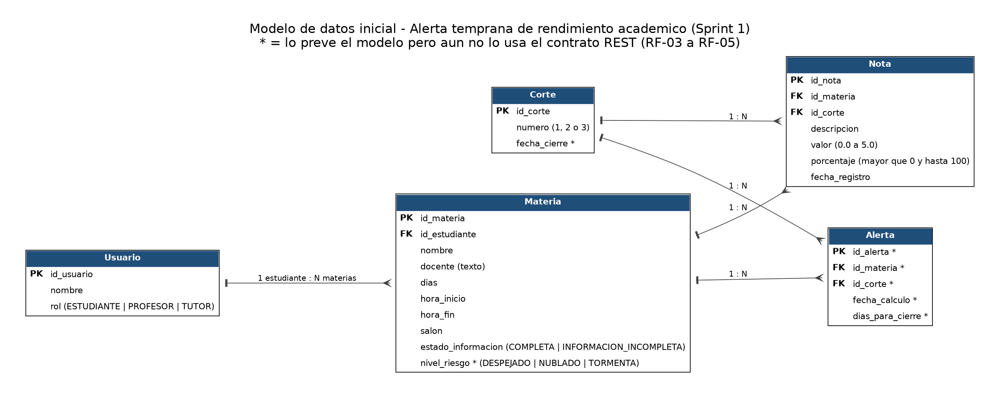

# Modelo de datos inicial

Proyecto: Alerta temprana de rendimiento académico (Grupo 5). Entregable de Datos del Sprint 1 (Jira: SCRUM-8), revisado por Backend contra el contrato REST (SCRUM-7 y SCRUM-14).

Estado: borrador inicial. En este sprint los datos viven en memoria (sin base de datos) y se usa un estudiante de prueba fijo, sin autenticación.

## Diagrama

El asterisco (*) marca lo que el modelo ya prevé pero el contrato REST del Sprint 1 todavía no usa (RF-03 a RF-05).

## Entidades

| Entidad | Atributos (PK / FK) | Estados | Relaciones | Restricción / RN |
|---|---|---|---|---|
| Usuario | **PK** id_usuario, nombre, rol | ESTUDIANTE, PROFESOR, TUTOR | Como estudiante tiene muchas materias | Cada rol solo accede a lo suyo (RN-04, RNF-02). En el Sprint 1 se usa un estudiante de prueba fijo |
| Corte | **PK** id_corte, número (1, 2 o 3), fecha_cierre* | — | Tiene muchas notas y alertas* | La fecha de cierre es obligatoria para calcular alertas (CDU-03) |
| Materia | **PK** id_materia, **FK** id_estudiante, nombre, docente (texto), días, hora_inicio, hora_fin, salón | Información: COMPLETA / INFORMACION_INCOMPLETA (se calcula: cada corte con notas suma 100%, RF-04). Riesgo*: DESPEJADO / NUBLADO / TORMENTA | Pertenece a un estudiante; tiene muchas notas y alertas* | Nombre, docente, horario y salón obligatorios (CA-01.2). Si la información está incompleta no se calcula riesgo ni alerta (RN-01, RNF-03) |
| Nota | **PK** id_nota, **FK** id_materia, **FK** id_corte, descripción, valor, porcentaje, fecha_registro | — | Pertenece a una materia y a un corte | Valor entre 0.0 y 5.0 (CA-02.2, CA-02.3). Porcentaje mayor que 0 y hasta 100. Los porcentajes de un corte en una materia suman máximo 100% |
| Alerta* | **PK** id_alerta, **FK** id_materia, **FK** id_corte, fecha_cálculo, días_para_cierre | — | Pertenece a una materia y a un corte | Guarda fecha y corte (RNF-01) y días para el cierre (RF-05). Solo existe si la información está completa (RN-01). Siempre sale con la opción de asesoría (RN-02) |

## Supuestos y decisiones

- **Rango de notas:** 0.0 a 5.0.
- **Docente:** texto en el Sprint 1. Pasa a ser un usuario con rol profesor cuando exista autenticación.
- **Roles:** estudiante, profesor y tutor (se usa "tutor" por consistencia; "monitor" aparece en algunos documentos).
- **Corte:** el contrato recibe el corte como número (1, 2 o 3), que corresponde a `Corte.número`.
- **Riesgo:** los criterios para clasificar Despejado, Nublado y Tormenta no están definidos. De forma provisional, "en riesgo" es un promedio entre 3.0 y 3.5 (una nota perdida está por debajo de 3.0).
- **Información completa (RF-04):** regla propuesta, pendiente de confirmar por Producto: cada corte que tenga notas debe sumar 100%.
- **Alcance:** las solicitudes de tutoría (RF-06 y RF-07) y la evolución del promedio (RF-08) no están en este modelo inicial.
